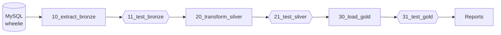

# DW Wheelie

A data warehouse for **Wheelie**, a car rental company, built on **Databricks** (Delta Lake, Spark SQL).
Data is extracted from the operational MySQL database `wheelie` and loaded through a medallion architecture
into a star schema used for reporting on rentals, payments and car servicing.

## Architecture

| Layer | Schema | Purpose |
|---|---|---|
| Bronze | `landing` | Raw 1:1 copy of the MySQL tables, overwritten on every run |
| Silver | `staging` | Cleansed and conformed data (cars, geography lookups, equipment groups) |
| Gold | `dw` | Dimensional model – facts, dimensions (SCD1/SCD2) and bridge tables |

Each layer is followed by a data quality gate – if a blocking test fails, the next step does not run.

## Repository structure

| Path | Description |
|---|---|
| `00_init.ipynb` | Creates the schemas, staging/dw tables and the `dw.calendar` table. **Drops all existing schemas and data.** |
| `10_extract_bronze.ipynb` | Copies every MySQL table into `landing` (one thread per table) |
| `11_test_bronze.ipynb` | Runs the bronze data quality tests |
| `20_transform_silver.ipynb` | Cleanses cars and geography, builds equipment groups in `staging` |
| `21_test_silver.ipynb` | Runs the silver data quality tests |
| `30_load_gold.ipynb` | Loads dimensions, bridge tables and facts into `dw` |
| `31_test_gold.ipynb` | Runs the gold data quality tests |
| `tests/` | pytest data quality suites (see [Data quality tests](#data-quality-tests)) |
| `delete_stag_dw_data.ipynb` | Utility: deletes all rows from the `staging` and `dw` tables |
| `config.example.py` | Template for the MySQL connection settings |

**Naming convention**: pipeline notebooks are prefixed with a two-digit number – the first digit is the layer
(`1` bronze, `2` silver, `3` gold), the second is the step within the layer (`0` load/transform, `1` tests).
The gaps leave room for new steps (e.g. `22_...`) without renaming existing files. `00_init` is the one-off setup;
the utility notebook `delete_stag_dw_data` has no number.

## Getting started

1. **Clone the repository into Databricks** as a Git folder (*Workspace → Create → Git folder*).
2. **Configure the MySQL connection**: copy `config.example.py` to `config.py` next to it and fill in
   `MYSQL_HOST`, `MYSQL_USER` and `MYSQL_PASSWORD`. `config.py` is git-ignored – never commit credentials.
3. **Initialise the warehouse** (first run only, or to rebuild from scratch): run `00_init`.
4. **Run the pipeline** in this order, either manually or as a Databricks Job with one task per notebook:
   `10_extract_bronze` → `11_test_bronze` → `20_transform_silver` → `21_test_silver` → `30_load_gold` → `31_test_gold`.

The gold load is incremental (MERGE / INSERT of new rows), so the pipeline (everything except `00_init`) can be
re-run to pick up changes from the source.

## Data model (gold)

**Facts**

| Table | Grain | Measures |
|---|---|---|
| `fact_rental` | one rental | `rental_amount`, `payment_amount`, `daily_rental_rate`, `rental_duration`, `payment_delay_days` |
| `fact_service` | one car service | `service_cost` |

**Dimensions**

| Table | History | Notes |
|---|---|---|
| `dim_car` | SCD2 | One row per car in the fleet (`inventory_id`) with model, fuel type and prices |
| `dim_customer` | SCD2 | Customer with address, city and country |
| `dim_store` | SCD2 | Store with address and manager; stores removed from the source are closed |
| `dim_staff` | SCD1 | Staff member with store and direct manager |
| `dim_manager` | SCD1 | Staff members who manage other staff |
| `dim_equipment` | SCD1 | Single equipment items |
| `dim_equipment_group` | – | Unique combinations of equipment fitted to a car |
| `dim_rental_date`, `dim_service_date` | – | Role-playing date dimensions built from `dw.calendar` (incl. weekend and COVID-period flags) |

**Bridge tables**

| Table | Purpose |
|---|---|
| `bridge_staff_hierarchy` | Every staff member linked to all managers above them, with `distance` (1 = direct manager) |
| `bridge_equipment_group_equipment` | Equipment items belonging to each equipment group |

SCD2 dimensions use `valid_from`, `valid_to` (`9999-12-31` for the current version) and `is_active`.
Unpaid rentals have `payment_date = 9999-12-31` and `payment_amount = 0`.

## Data cleansing rules (silver)

| Rule | Reason |
|---|---|
| Fuel type normalised to `Diesel` / `Petrol` (by first letter), other values set to NULL | Inconsistent spelling in the source |
| Purchase price `111` → `111000` | Data entry error |
| Missing or future production year → current year | Invalid values in the source |
| Production year of car `inventory_id = 526` → `2017` | The car was rented before its recorded production year |
| Country `Czechia` (id 108) merged into `Czech Republic` (id 3) | Duplicate country in the source |

The last two are assumptions made by the team; in a real project they should be confirmed with the data owner.

## Data quality tests

Tests are written with **pytest** and split by layer – each layer checks what it produces, before the next layer reads it:

| Suite | Blocks the pipeline when | Reports as a warning |
|---|---|---|
| `tests/test_bronze.py` | A table is missing or empty, required columns are missing, row counts differ from MySQL, primary keys are duplicated | Source data issues (orphaned references, multiple payments per rental, invalid dates) |
| `tests/test_silver.py` | Cleansing rules were not applied, keys or lookups are inconsistent, equipment groups are incomplete or unstable | Suspicious values (very low prices, cars without equipment, addresses without a country) |
| `tests/test_gold.py` | Source vs warehouse reconciliation fails, keys or foreign keys are invalid, SCD2 history is broken, measures are miscalculated, date dimensions or bridges are wrong | Business anomalies (overpayments, very long rentals, customer age) |

Each check is a SQL query returning the rows that **violate** a rule – an empty result means the check passes.
Checks with severity `error` fail with an `assert` (the message includes the row count, sample rows and the query);
checks with severity `warning` pass but appear in the pytest warnings summary.

**Running the tests**

- **On Databricks**: run the matching test notebook (`11_test_bronze`, `21_test_silver` or `31_test_gold`). It installs pytest, runs the suite and raises an
  exception if any blocking check fails, which stops a Databricks Job.
- **Locally**: install [Databricks Connect](https://docs.databricks.com/en/dev-tools/databricks-connect/python/index.html)
  and pytest, configure a Databricks profile, then run `pytest tests/`.

Useful options: `-m critical` (blocking checks only), `-k C01` (a single check), `-v` (one line per check).

**Adding a check**: add a `Check(id, name, sql, severity)` – or use the `unique`, `not_null`, `foreign_key`
helpers from `tests/data_checks.py` – to the `CHECKS` list of the relevant suite. Check ids must be unique within a suite.
